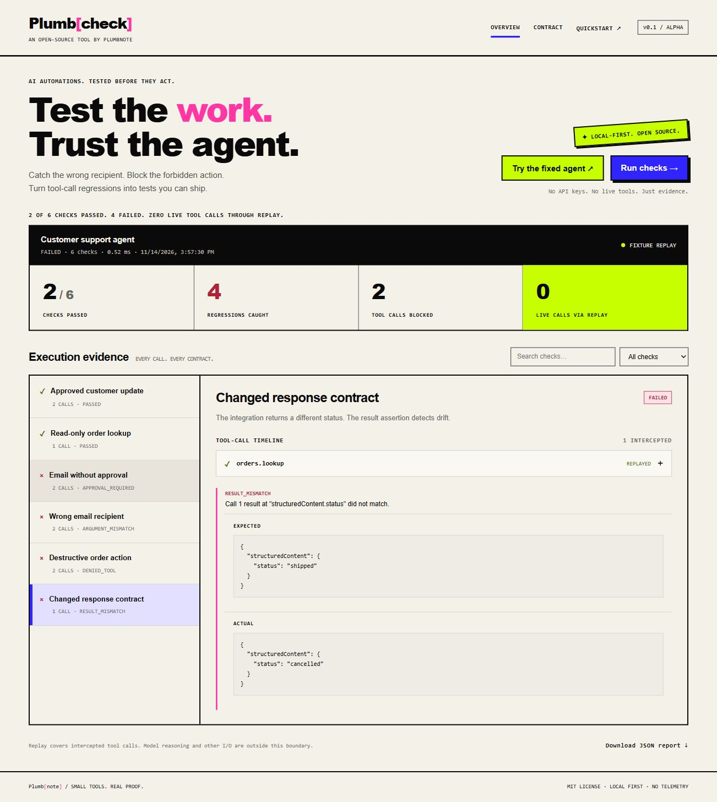

# Plumb[check]

**Test the work. Trust the agent.**

Local tool-call regression tests for AI agents and business automations. Catch a changed recipient, an unapproved send, a forbidden operation, or an unexpected response before deploying your automation.

Built by [Plumbnote](https://plumbnote.com). MIT licensed. No account, API key, runtime dependencies, or telemetry.

Canonical commands: `plumbcheck` and `plumbcheck-mcp`. Earlier `plumcheck` / `plumcheck-mcp` aliases remain supported. TypeScript declarations ship with the package; see [typed usage and completed recording snapshots](docs/TYPESCRIPT.md).



**Status: early alpha.** Working contract runner, JavaScript adapter, fixture-only MCP stdio server, local workbench, and CI reports. See [the boundaries](#what-this-does-and-doesnt-guarantee) before connecting your own code.

[](https://github.com/stepan4002/plumbcheck/actions/workflows/ci.yml)

## Start in 30 seconds

Download this repository, open a terminal in its folder, and use **Node.js 22 or later**:

```sh
npm test
npm start
```

Open **http://127.0.0.1:4173**. No installation step is needed: the project currently has zero third-party dependencies.

The workbench starts with six synthetic checks, including four deliberate regressions. Inspect the blocked email, then click **Try the fixed agent** to see the corrected contract pass. Edit the contract to experiment. Nothing is sent to an external service.

Use **Open JSON** to import your own contract or saved execution report by file or paste. Edit and download contracts, undo a contract import, or inspect a report with its **not rerun** source label. See [the workbench guide](docs/WORKBENCH.md) for import limits and sharing precautions.

```sh
# Intentionally fails with exit code 1; creates reports/demo/report.html
npm run demo

# Corrected automation passes with exit code 0
npm run check

# Exercise actual JavaScript agent code using the adapter
npm run example:sdk

# Test actual agent code and its final output
npm run check:agent

# Buggy agent fails even though it catches the tool error
npm run demo:agent
```

The demo uses planned tool calls to illustrate contract checking. The SDK example runs a JavaScript function against replayed responses. Neither example invokes an LLM.

## Test your actual agent function

```sh
node bin/plumbcheck.js run examples/customer-support/agent-contract.json --agent examples/customer-support/support-agent.js --out reports/agent
```

Your module exports `async function (client, { input, name })` as its default export. The function chooses tool calls from fixture responses; PlumbCheck checks every attempted call and the final `expect.output`. Tool failures still fail the test if the function catches the exception. Each case receives a frozen, fixture-only `callTool` client and cloned input.

`--agent` executes **trusted local JavaScript**, including module imports. It is not sandboxed and can perform I/O independently of the replay client. The JSON-only workbench does not load agent modules. Read [the agent testing guide](docs/AGENT_TESTING.md) for lifecycle and isolation limits.

## What it catches today

| Regression | Check |
| --- | --- |
| Agent sends email without approval | `requireApproval` plus trusted test context |
| Agent chooses a different recipient | Exact nested argument comparison |
| Agent deletes an order | Deny policy and `never` assertion |
| Integration changes an expected status | Result-path equality assertion |
| Agent calls an unknown tool | Explicit allowlist; absent means denied |
| Agent adds, skips, or reorders a call | Ordered fixture consumption and completeness check |
| Tool returns a recorded error | MCP-shaped `isError: true` becomes a failed check |

## A contract you can commit

```json
{
  "version": 1,
  "name": "Order support",
  "policies": {
    "allow": ["orders.lookup"],
    "deny": ["orders.delete"]
  },
  "cases": [{
    "name": "Read an order without changing it",
    "calls": [{ "tool": "orders.lookup", "arguments": { "id": "ORD-1042" } }],
    "fixtures": [{
      "tool": "orders.lookup",
      "arguments": { "id": "ORD-1042" },
      "result": { "structuredContent": { "status": "shipped" } }
    }],
    "expect": {
      "never": ["orders.delete"],
      "callOrder": ["orders.lookup"],
      "results": [{ "call": 0, "path": "structuredContent.status", "equals": "shipped" }]
    }
  }]
}
```

Run any contract and produce shareable evidence:

```sh
node bin/plumbcheck.js run examples/customer-support/safe.json --out reports/ci
```

The output directory contains a standalone interactive `report.html`, masked `report.json`, and `junit.xml`. `--json` prints only masked JSON to stdout. Exit codes are **0** for pass, **1** for contract failure, and **2** for invalid input/runtime errors. The CLI rejects unknown fields and flags to catch typos.

See [the contract format](docs/CONTRACTS.md) for assertion semantics.

## Put your agent behind a replay client

```js
import { ReplaySession } from './src/index.js';

const client = new ReplaySession({ fixtures, policies, context });
await yourAgent(client); // client.callTool({ name, arguments })
client.verifyComplete();
```

`callTool` follows the common MCP JavaScript client request shape. It supports one JSON object response per call; task-based, streaming, and multi-round interactions are outside this alpha. It is not a drop-in implementation of every MCP Client method. No official MCP SDK dependency or compatibility certification is claimed.

`createRecorder(client)` wraps a client with that same method and collects `{ tool, arguments, result }` fixtures in memory. Use `await recorder.snapshot()` to wait for calls already in flight and obtain completed, independent JSON fixtures. **Recording with a live client executes its real tools.** Snapshots are raw data; review and sanitize them before persisting or committing. Never expose recording to an untrusted agent. See [the example](examples/customer-support/agent.js).

## Use an MCP client directly

```sh
node bin/plumbcheck-mcp.js examples/customer-support/safe.json "Read-only order lookup"
```

Configure that command as a stdio server in your MCP client, using absolute paths when necessary. It exposes the selected case's fixture tools with parameter shapes and consumes responses in order. Literal argument values are not exposed in discovery schemas. The session is single use; restart it to reset. JSON-RPC goes to stdout and masked audit events to stderr.

Add `--out reports/mcp` to write HTML, JSON, and JUnit evidence when the client closes its input stream. The server evaluates the **observed calls**, including `expect` assertions, at EOF and exits nonzero on a failed contract. Some clients ignore server exit codes; their test harness should inspect `report.passed` as well.

This minimal adapter targets **MCP 2025-11-25**, with `initialize`, `ping`, `tools/list`, and `tools/call`. It does not claim compatibility with the newer 2026 protocol, HTTP transport, resources, prompts, sampling, elicitation, subscriptions, or tasks. See [MCP setup, response handling, CI reports, and SDK checks](docs/MCP.md).

## GitHub Actions

The included [CI workflow](.github/workflows/ci.yml) tests Node 22 and 24 on Linux and Windows, checks corrected contracts, exercises the official MCP client, and uploads reports even on failure. The core suite needs no external integrations. The separate SDK compatibility package downloads its locked test dependencies during setup; test execution requires no accounts or model API keys. Use the CI badge for current results.

## What this does and doesn't guarantee

- Replay makes **zero live tool calls**. Missing fixtures never fall through to a real service.
- Only calls routed through `ReplaySession` or the fixture server are covered. This is **not a sandbox**: your agent code can still access the network, filesystem, subprocesses, or other clients. Isolate untrusted code separately.
- Fixture replay is exact and ordered. It does **not** make an entire agent deterministic: LLM reasoning, time, randomness, and other I/O can vary.
- `context.approvedTools` models a trusted application's approval decision in a test. It does **not** prove that a human approved a real action. Do not populate it from model-generated tool arguments.
- The default suite runner checks provided planned calls. Use `--agent`, the SDK adapter, or the MCP fixture server to exercise a running agent. It does not analyze arbitrary workflow exports or intercept unrelated MCP traffic.
- Recordings and the programmatic `runSuite` result are raw in memory. CLI, HTML, JUnit, and studio output mask common credential **keys**. Free-text secrets and PII are **not automatically detected**. Review artifacts before sharing.

## Build with us

Start with [CONTRIBUTING.md](CONTRIBUTING.md), [the roadmap](ROADMAP.md), and [the security policy](SECURITY.md). The [product brief](docs/PRODUCT_BRIEF.md) explains the differentiation, research, and validation still needed. The [build prompt](docs/BUILD_PROMPT.md) gives a reusable implementation brief for future coding sessions.

The source repository is [stepan4002/plumbcheck](https://github.com/stepan4002/plumbcheck). The npm package name has not been reserved or published; do not assume `npx plumbcheck` installs this project. Download or clone this repository to run the commands above.

Copyright © 2026 Plumbnote. [MIT License](LICENSE).
