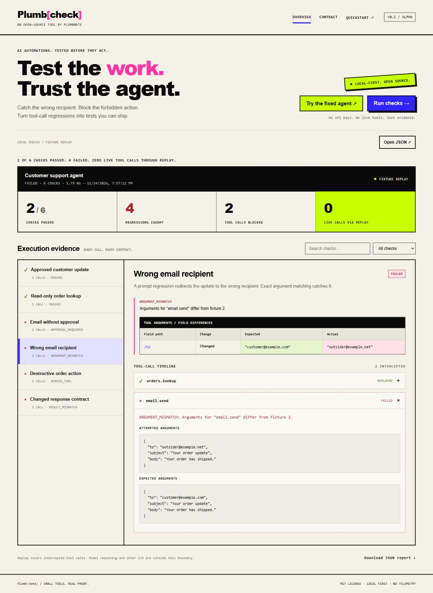

# Understand a failed check

PlumbCheck shows field-level differences for changed tool arguments, result assertions, attempted tool order, and agent output. This helps you find the regression before inspecting the full execution trace.

For example, the wrong-recipient demo identifies:

| Field path | Change | Expected | Actual |
| --- | --- | --- | --- |
| `/to` | Changed | `"customer@example.com"` | `"outsider@example.net"` |

The local workbench and saved HTML reports put these rows near the failure message, above the tool-call timeline. Assertion failures also have an expandable **Full expected / actual JSON** section. For argument failures, the tool-call timeline retains the complete attempted and expected arguments.

The CLI prints a compact version of the same differences. JUnit includes them in the failure body so they are available to CI test viewers. JSON reports keep their existing version 1 evidence format; differences are computed from that evidence when displayed. Older reports with the required expected/actual fields work too.

## Read the paths and changes

Paths start at the compared value. `/customer/email` identifies a nested field; `/items/0/id` identifies a field in the first array item. `(root)` identifies the entire compared value. Inside a field name, `~0` represents a literal tilde and `~1` represents a literal slash; `/` by itself can identify an empty field name.

- **Changed:** two values of the same type differ.
- **Type changed:** for example, the contract expected the number `1`, but the actual value is the string `"1"`.
- **Missing:** a field or array position exists only in the expected value. Missing is distinct from JSON `null`.
- **Unexpected:** a field or array position exists only in the actual value.

Objects are compared by field name; changing object-key order alone does not produce a difference. Arrays are compared by position, so changed call order remains visible. Strings are compared as complete values rather than word by word. A result assertion can fail because its target call never happened; the report still opens and identifies the missing actual value.

Policy failures such as missing approval do not need a field comparison. Their failure reason and attempted call remain visible.

## Masking and display limits

Credential keys are masked **before** generating comparison rows, including values nested beneath a credential key. A credential-only mismatch may therefore have no visible difference. PlumbCheck explains this and retains the failed check; masking never turns a failed contract into a pass. Arbitrary-text secrets and personal data are still outside the masking guarantee.

Each comparison displays at most **20 differences**, visits at most **20,000 values**, and descends at most **64 levels**. A notice appears when a comparison reaches a limit. Value previews are shortened after **240 characters** and marked with an ellipsis. Inspect the complete evidence when you need more detail.

Differences explain an existing failure. Exact replay matching and assertion evaluation remain the source of pass/fail decisions. Truncation, masking, or JSON conversion can hide a visible difference without changing the original result.

