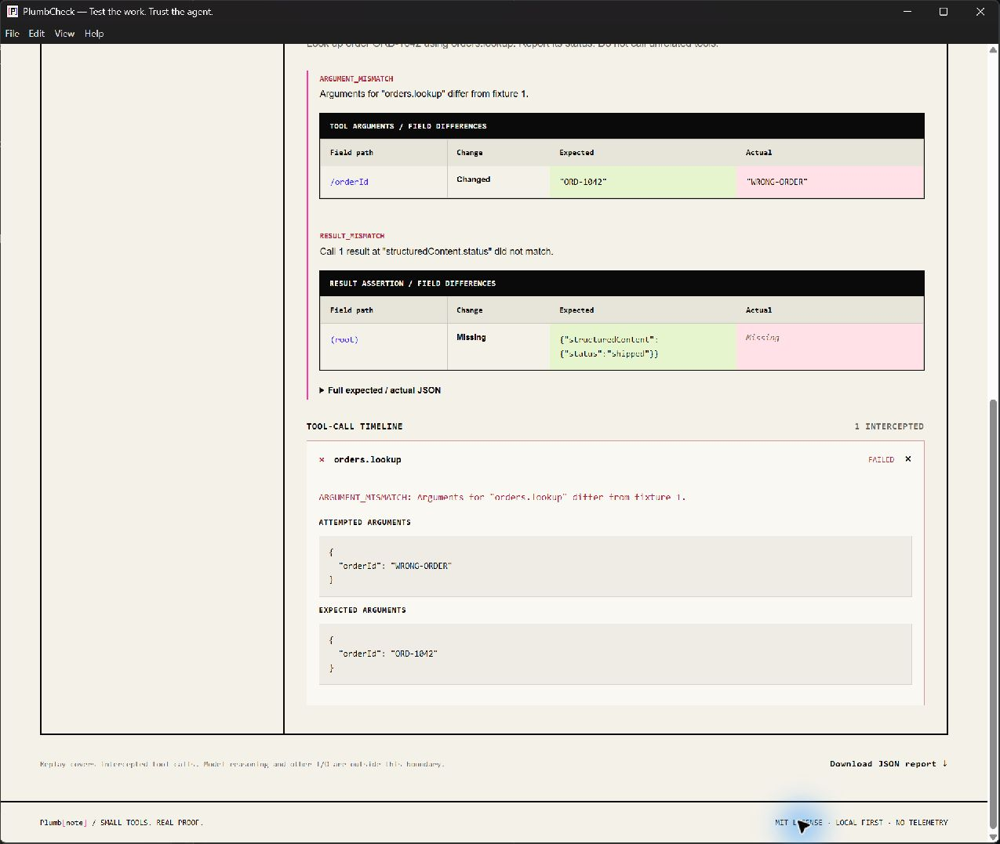
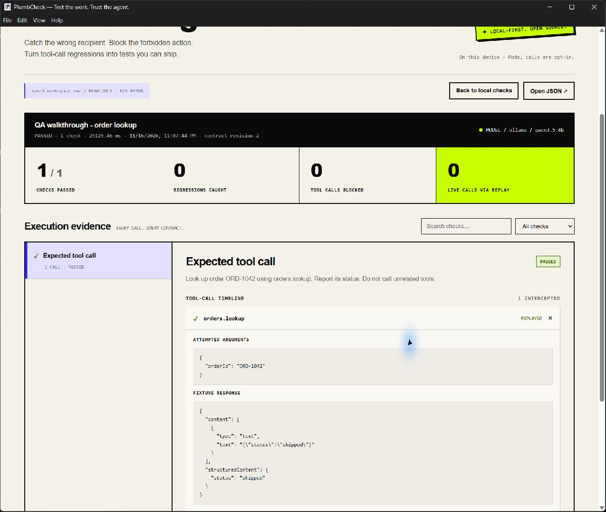

# Use PlumbCheck: a tested Windows walkthrough

This walkthrough was exercised through the downloaded preview.5 Windows application's native interface on 16 November 2026. Its application archive matched the verified CI build. The test project is **QA walkthrough - order lookup**; existing saved projects were preserved.

PlumbCheck checks attempted tool calls against a test you define. You supply a task, expected arguments and a simulated response. Offline mode checks authored planned calls. Model mode lets the selected model choose its own calls, then checks them against the same fixtures. The model runs for real; business-tool responses are simulated.

| Observed check | Result |
| --- | --- |
| Save a new project through the form builder | Revision 1, one scenario |
| Offline call with `WRONG-ORDER`, expecting `ORD-1042` | Failed 0/1; the inspector showed both values at `/orderId` |
| Correct the planned ID and save the same builder project | Revision 2, still one scenario |
| Rerun offline | Passed 1/1; the earlier failed run remained in History |
| Run revision 2 with Ollama / `qwen3.5:4b` | Passed 1/1, one intercepted call, two model steps; 786 input / 142 output tokens |
| Download JSON report | Native Save dialog opened; the user completed Save. The exported file passed report validation and matched the project, model and revision |

## Try the first test

1. Open **Workspace → Start here / Build your first test**.
2. Choose **Order lookup** and select **Load template** if changing templates. The selector alone does not replace the form fields.
3. Give the project a name. Keep tool `orders.lookup`, field `orderId`, expected value `ORD-1042`, and simulated response `status = shipped`.
4. Set **Planned offline value** to `WRONG-ORDER`. Choose **Save this test**.
5. Under **Run a saved test**, choose **Planned-call check**, then **Run saved project**. (If a model connection is already saved, the Workspace preselects **Real model test**; switch back for this offline step.)
6. In **History**, choose the new run's **Inspect** button. Expect `ARGUMENT_MISMATCH` and the changed `/orderId` value. A missing-result assertion can also fail because the mismatched call produced no valid fixture response.
7. Return to Workspace. In the builder, change only the planned value to `ORD-1042`, save and run again. Keep the builder project open so this updates it rather than creating another project. Expect 1/1 passed; both runs remain in History.

## Let your local model choose the call

1. Start your existing Ollama server and a tool-capable model on the PC running PlumbCheck. On this machine, the saved **Ollama · Qwen 3.5 4B** connection was used. If there is no connection, choose **Find Ollama on this PC**, select an installed model and save.
2. Select **Model chooses tools**, then your saved connection. Review the task: “Look up order ORD-1042 using orders.lookup. Report its status.”
3. Authorize sending that scenario and its fixture responses to the selected model. The native check used 180 seconds, four steps, 1,024 output tokens per step and 4,000 output tokens per run.
4. Choose **Run saved project**. Inspect the new History row. The tested Qwen run called `orders.lookup` with `orderId: ORD-1042` and reported the simulated shipped status.
5. Use **Download JSON report** to save evidence. Choose a distinct filename to retain earlier exports. Opening an exported report later inspects it without rerunning the agent.

Changing a planned offline value does not force a model to make that call. Model mode uses your task and every tool the contract names; it does not receive the planned call as an expected answer. Discovery confirms server access, while a scenario verifies actual tool use.

This is a basic native first-use check, not a full platform certification. It did not test a fresh-account installation, upgrade/uninstall, physical Android, remote HTTPS sync, actual external assistant hosts or the full accessibility/security surface. Existing external agents use the separate MCP/SDK routes described in [the workspace guide](APP_WORKSPACE.md).
