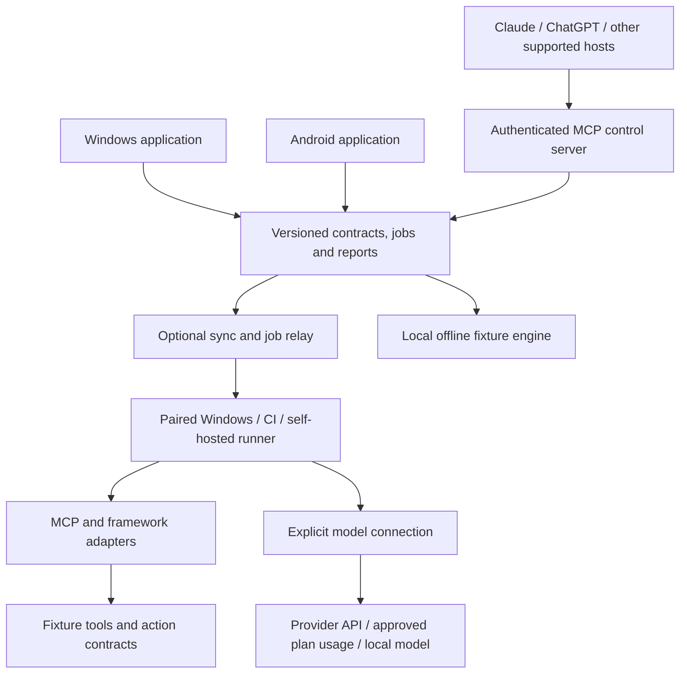

# PlumbCheck platform roadmap

> **Historical.** This document records planning or QA from the 0.2 previews and is kept for reference. It does not describe 1.0. For current direction see [ROADMAP.md](../ROADMAP.md); for what 1.x promises see [STABILITY.md](STABILITY.md).

Updated 16 November 2026 from the founder's Windows, Android, sync, multi-agent, and AI integration requirements. This is the product direction and delivery plan. Unchecked items are planned capabilities, not compatibility claims or shipped features. Milestones have exit criteria rather than unverified release dates.

## Product we are building

An independent agent-testing application for Windows and Android, with optional synced projects and reports. A user can also ask an AI assistant, such as Claude or ChatGPT, to create a test draft, run an authorized test, and explain the evidence through a PlumbCheck integration.

Three complementary ways to use it:

1. **Standalone:** open the app, choose an agent connection and a scenario, run checks, inspect failures, and compare against a reviewed baseline.
2. **From an AI assistant:** ask, for example, “Run the customer-support regression suite and show what changed.” The assistant calls PlumbCheck testing tools and receives real job results.
3. **From code and CI:** use the CLI/SDK or a framework adapter, keep contracts in Git, and attach reports to a pull request.

The local runner and useful offline functionality remain MIT licensed. Local testing must not require a Plumbnote account. Sync and remote execution are optional; a self-hostable path is part of the plan.

## Current evidence and the remaining gap

The 0.2 preview builds on exact fixture replay, a JavaScript agent runner, an explicit recorder, fixture MCP, typed exports, field differences, import/export, and Windows/Linux Node 22/24 CI. It adds saved app projects/jobs, model connections and usage/budgets, comparisons, a Python adapter, a separate local control MCP bridge/plugin, an Android APK preview, and optional snapshot sync.

The fixture server exposes **fixture tools to an agent being tested**. The new local control bridge exposes **saved offline PlumbCheck jobs** to an assistant. These have separate configurations and authority. Actual Qwen 3.5:4B decisions and an intentional regression have been checked; the packaged Windows interface also discovered and ran that model, inspected its report, and completed the native MCP save dialog. Android emulator checks exercised offline runs, native JSON export/import, project retention across an APK update, and direct native Ollama discovery/model runs with an observed pass and argument regression. Real-device/Keystore/HTTPS sync checks, actual assistant hosts, remote hosting, cloud API accounts, and signed public distribution remain open. See [verification](VALIDATION.md), [live evidence](LIVE_MODEL_VERIFICATION.md), and [release gates](../release-readiness.json).

## Connection types must stay separate

| Connection | What it does | Planned route |
| --- | --- | --- |
| Agent under test | Executes the user's agent against intercepted tools | MCP fixture server, JavaScript/Python SDK, framework adapters |
| Model provider | Supplies reasoning or generates proposed tests | OpenAI, Anthropic, Gemini APIs; Ollama; LM Studio; compatible endpoints |
| Assistant integration | Lets a user ask an existing AI app to operate PlumbCheck | MCP control server and host-specific plugin/extension packaging |
| Runner | Performs the authorized test | Windows worker, CI, self-hosted worker; optional isolated managed worker |
| Device | Edits scenarios and displays evidence | Windows app and Android app, sharing versioned data |

Changing a model provider does not automatically add support for an agent framework. An adapter must intercept that framework's actual tool calls. Every advertised integration needs its own reproducible test and a published capability boundary.

## Delivery sequence

| Milestone | Main outcome | Depends on | Exit evidence |
| --- | --- | --- | --- |
| M1 · Windows foundation | Download an `.exe`, run the demo, inspect a real MCP test | Existing alpha | Built executable tested as an app and subprocess; downloadable artifact and checksum |
| M2 · Ask an assistant to test | Claude/ChatGPT can invoke an authorized PlumbCheck run | Versioned jobs and MCP control tools | Actual host walkthroughs with successful, failing, canceled, and denied jobs |
| M3 · Models and agent adapters | Test across providers and at least two agent families | Capability contracts and secret storage | Provider/adapter matrix backed by integration checks |
| M4 · Windows–phone sync | Pair devices and reliably sync projects, jobs, and reports | Stable project/revision/job IDs and authentication | Offline/reconnect, conflict, revocation, and duplicate-job tests |
| M5 · Android beta | Useful Android app with offline checks and paired execution | Portable fixture core; M4 for synced features | Signed APK, real-device tests, desktop/phone parity scenarios |
| M6 · Public beta and 1.0 | Distribution, reliability, and independent repeat use | Prior milestone gates | Security/accessibility review, signed builds, developer walkthroughs and repeat CI use |

Start the Android portability prototype during M2 so desktop-only assumptions are discovered early. A read-only phone companion is an early increment, not the completed Android milestone.

### M1 · Independent Windows application

- [ ] Windows x64 `.exe` installer plus portable ZIP with the runtime included; no Node.js setup for end users.
- [ ] Native app window, branded icon, keyboard support, useful startup errors, and explicit import/export/save flows.
- [ ] Save a fixture contract, select its test case, and generate MCP client configuration.
- [ ] Verify the packaged application's bundled MCP console helper with actual JSON-RPC input, failed-call behavior, clean shutdown, reports, and exit codes.
- [ ] Keep source CLI and CI workflows working. Produce a binary checksum and preserve upstream runtime license notices.
- [ ] Before broad distribution: code signing, a reviewed installer/update channel, rollback, and clean-machine validation. Add Windows ARM64 after x64 is stable.

### M2 · Claude, ChatGPT, and other assistant integrations

Build a **PlumbCheck control server**, separate from the fixture server. Start with a small tool surface:

| Proposed tool | Behavior and authority |
| --- | --- |
| `plumbcheck_list_projects` | List projects the signed-in user may access |
| `plumbcheck_validate_contract` | Validate a proposed contract without executing it |
| `plumbcheck_run_suite` | Start a job for a registered project/revision and supported runner |
| `plumbcheck_get_run` | Return status and masked execution evidence for a job ID |
| `plumbcheck_compare_runs` | Explain regressions between two authorized runs |
| `plumbcheck_cancel_run` | Request cancellation and report what actually stopped |

- [ ] Local stdio control endpoint for supported desktop/CLI hosts.
- [ ] Authenticated remote MCP endpoint for web/mobile hosts, using a maintained protocol implementation and explicitly tested protocol versions.
- [ ] ChatGPT plugin with tool descriptions, permissions, example prompts, and optional inline report UI. Test a data-only flow first; add MCP Apps UI when it improves inspection.
- [ ] Claude local extension/plugin and remote connector paths. Test each host separately; local and mobile capabilities differ.
- [ ] Validate Codex, Gemini CLI, Cursor, and VS Code/Copilot as follow-on hosts; publish supported versions instead of claiming all MCP clients work.
- [ ] AI-authored tests remain drafts until reviewed. Register project roots and allowed runners explicitly. The control API must not expose an arbitrary shell or accept an arbitrary module path from a model.
- [ ] Use job IDs, idempotency keys, progress, deadlines, cancellation, artifact links, and scoped authorization. Never let an assistant invent or mark a result as successful.

**Acceptance story:** In an actual supported assistant, ask it to run a saved suite, obtain the runner's report, identify the wrong-recipient difference, and rerun a reviewed correction. Also prove that another user's project, unauthorized runner, and duplicate job are rejected.

### M3 · API models, local models, subscriptions, and agent frameworks

Provider connections and assistant connections are different product features:

| Target | Planned support | Entitlement and implementation boundary |
| --- | --- | --- |
| OpenAI API | User-supplied project key and explicit model selection | Metered API use; enforce run budgets and project scope |
| ChatGPT plan inside PlumbCheck | Evaluate official Sign in with ChatGPT plan usage for OSS/local apps | User consent, eligible account/model, secure token storage, documented preview limits; not generic access to all ChatGPT capabilities |
| ChatGPT subscription as the assistant | User asks ChatGPT to call PlumbCheck control tools | Official plugin/MCP route and host/account availability |
| Claude API | Anthropic API credentials and provider adapter | API entitlement and billing; do not infer them from a chat plan |
| Claude subscription as the assistant | Claude calls PlumbCheck through its supported connector/extension | Keep login within Claude's approved flow; no session-cookie extraction |
| Gemini API | Gemini API key; Vertex AI later when demanded | Separate provider settings, credentials, limits, and regional availability |
| Gemini account/CLI | Evaluate the official signed-in Gemini CLI extension/MCP route | Use its supported account authentication and quotas; not an undocumented token bridge |
| Ollama | Local tool-capable models through supported endpoints | Detect capabilities; a compatible API shape does not mean every model supports tool use |
| LM Studio | Local server and supported tool-use endpoints | Test loaded model and server version, schemas, streaming, and malformed tool calls |
| Other compatible endpoints | Advanced custom base URL after the named providers work | Explicit destination and authentication; no unverified “works with every model” promise |

- [ ] Connection wizard, capability probe, model discovery, credential-store integration, and connection diagnostics.
- [ ] Per-run limits for cost, tokens, tool calls, elapsed time, retries, and concurrency. Display actual usage where available and label estimates.
- [ ] Keep API keys and OAuth refresh tokens out of contracts, report exports, prompts, and default sync.
- [ ] Record provider/model IDs, relevant generation settings, adapter version, fixture hash, and contract revision with results. Compare repeated stochastic runs without claiming whole-agent determinism.
- [ ] Support headless JavaScript agents and a Python/pytest adapter, followed by LangGraph/LangChain and an n8n workflow adapter selected with users. Evaluate OpenAI Agents SDK, Claude Agent SDK, CrewAI, and AutoGen on actual demand.
- [ ] For n8n or another workflow builder, define which nodes can be intercepted, how execution is triggered, and how side effects are mocked. Export import alone is not a tested adapter.
- [ ] Publish capability flags for recording, replay, final output, streaming, multi-agent handoffs, cancellation, and out-of-process isolation. Unsupported capabilities must be visible.

Agent categories to cover progressively:

| Agent category | Useful checks | Adapter / isolation requirement |
| --- | --- | --- |
| Business tool agents | Recipient, approval, allowed action, arguments, response/output | MCP or SDK tool interception; first priority |
| Workflow automations | Node inputs/outputs, ordering, retry behavior, external writes | Explicit n8n/other workflow adapter and mocked side effects |
| Research / RAG agents | Retrieval fixtures, citation/source expectations, output structure | Retrieval/search adapter; separate deterministic checks from optional model grading |
| Coding agents | Expected file changes, forbidden commands, tests, network access | Disposable workspace and isolated execution; never use an arbitrary user folder as a sandbox |
| Browser / computer-use agents | Intended navigation/form action, changed selectors, blocked writes | Browser/tool adapter and isolated test environment before claiming action coverage |
| Voice / conversational agents | Transcript scenarios, tool effects, turn timing, interruption recovery | Synthetic/consented recordings first; audio-provider adapters and privacy review later |
| Multi-agent systems | Handoffs, delegated tool authority, duplicate actions, shared budgets | Correlated agent/run IDs and assertions over the observed execution graph |

Each category needs a runnable example and published misses; choosing a platform or model name alone is not sufficient coverage.

**Acceptance:** The same synthetic business scenario runs through an MCP agent and an SDK/framework agent. At least one API model and one local model choose their own tool calls; intentional regressions fail. Provider outages, missing credentials, and budget exhaustion produce clear non-passing outcomes.

### M4 · Sync Windows and Android

Use one versioned project model across devices: project ID, contract ID/revision, scenario ID, runner/device ID, job ID, artifact hash, and result provenance. The phone is a real client of that model, rather than a second unrelated project store.

- [ ] Optional account/workspace plus QR or short-code device pairing, expiry, mutual confirmation, and device revocation.
- [ ] Sync contracts, approved baselines, masked reports, comments, and runner status. Raw traces/fixtures require separate opt-in and a preview of what leaves the device.
- [ ] Local database/cache on both devices; an outbox for offline edits; append-only run results. Use revision checks and explicit conflict resolution for simultaneous contract edits.
- [ ] Encrypted transport, scoped credentials, OS-backed secret storage, retention controls, and deletion propagation. Assess end-to-end encryption for sensitive artifacts and define which runner can decrypt them before promising it.
- [ ] A Windows runner makes an outbound authenticated connection; do not expose Studio or an unauthenticated model port publicly.
- [ ] Route only registered jobs to the paired worker. Show online/offline state. If the computer is asleep or offline, queue or refuse the job explicitly; do not report it as running.
- [ ] Idempotent dispatch, reconnect/resume, cancellation acknowledgement, event ordering, duplicate-result handling, and recovery after worker crashes.
- [ ] Self-hostable sync/relay service with migration/export support; evaluate an optional managed service after independent use.

**Acceptance:** Edit a scenario on a disconnected phone, reconnect, resolve a conflicting desktop edit, start one authorized test on Windows, and see the same immutable result on both devices. Revoking the phone stops further access. Reconnect must not execute the job twice.

### M5 · Android app with useful independent operation

The current prototype is a native Android WebView host with bundled local assets, the shared fixture engine and model loop, Android file pickers, Keystore-backed sync credentials, and a restricted native Ollama bridge. It has build/lint/native-unit/signature, parity, and actual emulator model-run evidence; actual-device verification remains open. Evaluate React Native/Expo if richer native workflows justify it rather than claiming the prototype proves every mobile requirement.

- [x] Extract a platform-neutral fixture/contract engine with parity tests against the Node runner. Keep file/process adapters outside that engine.
- [x] Offline on-phone contract validation, synthetic planned-call fixture tests, report viewing, editing, and scenario export/import (emulator verified; real-device gate remains).
- [x] Direct Ollama model discovery and bounded tool tests through native Android networking; Qwen pass/regression and native report exports verified on an emulator.
- [ ] Paired Windows/self-hosted runner jobs for agents that need Python, desktop tools, local MCP subprocesses, or a larger model. The UI names the execution device.
- [ ] Optional direct API-model tests on the phone with secure credentials and explicit data/budget controls, once the portable tool loop is verified.
- [ ] Sync projects and reports; send completion notifications that respect Android background limits. Show cancellation, offline, pending, and partial-result states clearly.
- [ ] Android share-sheet import of reviewed JSON test packs/reports, deep links to run results, TalkBack support, and touch-friendly evidence inspection.
- [ ] Signed APK testing on actual devices, battery/network/storage checks, upgrade migrations, and a Google Play distribution review.
- [ ] Later experiment: on-device small-model execution on supported hardware. Measure memory, thermal/battery cost, model licensing, and tool-use reliability before listing support.

An Android app can independently run the portable fixture engine. It cannot automatically execute arbitrary Windows binaries, Node/Python packages, or every agent framework. Those tests need a supported worker or adapter.

**Acceptance:** With no PC and no network, run a synthetic contract and inspect its failure on a real Android device. With a paired online PC, start an actual agent test from the phone and inspect the synced result. Verify both paths explicitly.

### M6 · Reliability, useful additions, and public release

- [ ] Guided first test: choose an agent connection, import/sanitize fixtures, define the action contract, demonstrate a real failure, and save it to CI.
- [ ] JSON Schema assertions and editor completion using a maintained validator; richer assertions for permitted variability without weakening default exact replay.
- [ ] Baseline comparison and reviewed promotion; never automatically accept a changed recipient because an AI suggested it.
- [ ] Configurable path-based sanitization, secret/PII review, retention presets, and a safe shareable evidence bundle.
- [ ] Versioned synthetic scenario packs: support, CRM updates, refunds, invoices, outreach, and data extraction. Include prompt-injection and forbidden-action cases with honest coverage limits.
- [ ] Multi-agent trace/handoff assertions, per-agent budgets, duplicate side-effect detection, and tool timeout/retry/failure simulation.
- [ ] API response drift tests, schema changes, malformed responses, partial executions, and recovery after interruption.
- [ ] GitHub Action/reusable workflow, PR evidence, headless Docker worker, and reproducible benchmark methodology. Live-model CI stays opt-in and uses reviewed secret handling.
- [ ] Isolated workers for untrusted code before accepting it through remote plugins or uploaded executable test packs. A replay client alone is not that isolation.
- [ ] Accessible desktop and Android UI, shared brand tokens, licensed fonts, localization-ready copy, and optional dark theme.
- [ ] Signed application/update artifacts, checksums, SBOM/license inventory, dependency updates, release channels, rollback, and migration tests.
- [ ] Five independent developer walkthroughs; publish the setup problems and actual fixes. Measure first useful failure, repeat use, suites kept in CI, and maintenance load alongside stars.
- [ ] After demonstrated demand: team roles/audit trails, enterprise SSO, more CI systems, macOS/Linux desktop packages, and iOS. Keep optional hosted features separate from the useful MIT core.

## Architecture direction

Model access, synced storage, and runner authorization have separate credentials and scopes. A cloud sync account must not implicitly acquire the ability to run arbitrary local code or spend a provider budget.

## Primary-source constraints checked for this plan

These sources establish possible integration routes, not completed PlumbCheck compatibility. Recheck them before implementing or advertising support.

- OpenAI documents MCP-backed plugins with optional UI, and connection through public HTTPS or Secure MCP Tunnel. Public submission has its own endpoint/review requirements. [Plugin quickstart](https://developers.openai.com/plugins/build/app-quickstart), [connect and test](https://developers.openai.com/plugins/deploy/connect-chatgpt).
- OpenAI documents consent-based ChatGPT plan usage for open-source/local apps. Its preview has specific request/tool limitations; it is not equivalent to unrestricted API-key access. [Plan usage](https://developers.openai.com/siwc/token-sharing-open-source), [preview limits](https://developers.openai.com/siwc/token-sharing-open-source/preview-limitations).
- Eligible ChatGPT plans may separately claim API credits through an official account-linking flow. Treat eligibility, grants, and expiry as account/program-specific; do not promise every subscription includes them. [Subscriber API credits](https://developers.openai.com/api/docs/guides/chatgpt-api-credits).
- Claude distinguishes local desktop extensions from remote connectors; remote connectors are the path across web/mobile surfaces. Remote calls originate from Anthropic infrastructure, which affects networking and data disclosure. [Desktop versus remote](https://support.claude.com/en/articles/11725091-when-to-use-desktop-and-web-connectors), [remote connector requirements](https://support.claude.com/en/articles/11175166-get-started-with-custom-connectors-using-remote-mcp).
- Gemini CLI documents its supported Google-account and API-key authentication routes, including subscription-associated accounts. This is not proof of a PlumbCheck integration. [Gemini CLI authentication](https://geminicli.com/docs/get-started/authentication/).
- Ollama supports a subset of OpenAI-compatible APIs; LM Studio documents tool-use endpoints and model-dependent tool-call behavior. Capability tests are required. [Ollama compatibility](https://docs.ollama.com/api/openai-compatibility), [LM Studio tool use](https://lmstudio.ai/docs/developer/openai-compat/tools).

## Next implementation order

Next, verify the new Android connector on a physical device, finish clean-account Windows install/upgrade checks and publisher signing, and walk through an actual assistant host. Validate an authorized cloud-model connection, then implement authenticated worker dispatch and cross-device conflict handling before claiming synced agent execution. The implemented portable engine, local model loop, control bridge, and snapshot relay are foundations; they do not close those gates.
