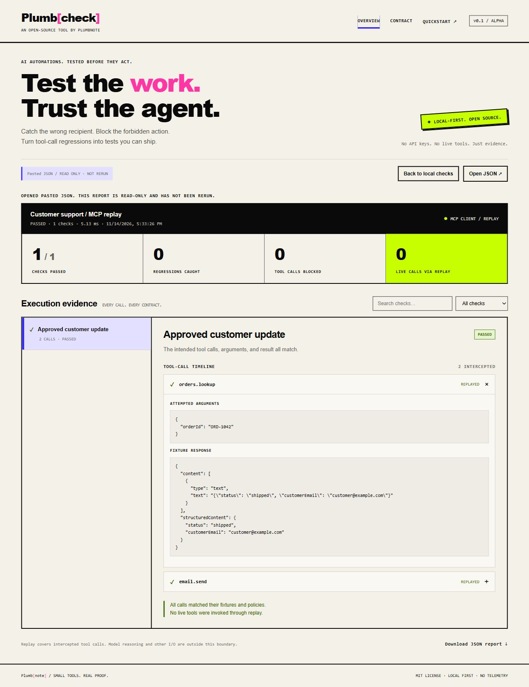

# Local workbench

Run `npm ci` and `npm start` from the downloaded repository with Node.js 22 or later, then open the **private launch link printed by Studio**. The Windows application bundles this interface and its runtime. Offline checks need no account or model API key; the complete application uses the pinned dependencies installed by `npm ci`.

Workspace includes a form-based one-tool scenario builder and guided local Ollama discovery. See [the first-test walkthrough](APP_WORKSPACE.md). The Contract tab retains advanced JSON editing. Initial Results are explicitly labeled as a built-in example until you run or open evidence.

## Open a contract or a saved report

Choose **Open JSON**, then choose a local JSON file or paste its contents. The workbench recognizes version 1 planned-call contracts, agent-code contracts, and fixture/agent/MCP replay reports.

- **Planned-call contract:** review and edit the JSON, then choose **Run this contract** to run it through the local fixture runner.
- **Agent-code contract:** edit and download the JSON here. Run it from the CLI with `--agent path/to/trusted-agent.js`; the browser never imports or executes an agent module.
- **Saved report:** inspect its cases, tool-call timeline, and failure evidence. The source banner says **READ ONLY · NOT RERUN**. Opening a report does not execute its calls. **Back to local checks** restores the last local result.

Importing a contract preserves the previous editor text behind **Undo contract import**. This is one level of undo, including an unfinished or invalid draft. Invalid imports leave the current report and editor unchanged. Drafts and imported reports live in the tab; download your work before closing or reloading it.

## Download and share

Failed argument, result, order, and agent-output checks include a field comparison above the timeline. Inspect a changed path directly, then expand the complete JSON or tool-call evidence when needed. See [reading field differences](DIFFERENCES.md).

**Download contract** validates and exports the current editor contents, including raw fixture data. It does not export whichever example happened to be selected earlier. A downloaded planned-call contract can be run with:

```sh
node bin/plumbcheck.js run path/to/plumbcheck-contract.json --out reports/check
```

**Download JSON report** exports the report being viewed. Imported reports are masked again for common credential keys. Reports do not contain the complete original contract and cannot reconstruct one.

The standalone HTML report generated by `--out` embeds the workbench runtime and its import helpers. It can inspect another saved JSON report without the Studio server. Contract editing and execution require Studio.

## Limits and trust

Imports accept at most **1,000,000 UTF-8 bytes**, **64 nesting levels**, and **100,000 JSON values**. Reports must contain 1–1000 cases. The validator checks supported modes, event indexes and statuses, failure evidence, and consistency between case outcomes and summary totals. A structurally valid report is not authenticated or signed: its contents are still assertions made by whoever supplied it.

File and paste imports are processed in the browser tab. Choosing **Run this contract** sends a planned-call contract to the local Studio server for fixture replay. There is no upload to Plumbnote or a model provider. The CLI's trusted agent-code runner has separate I/O capabilities; see [agent testing](AGENT_TESTING.md).

Credential masking recognizes common field names. Secrets inside arbitrary text and personal data can remain. Contracts deliberately retain fixture values so exact replay still works. Review every artifact before sharing it. Resource limits and escaped rendering reduce import risks; they are not an external security audit.


